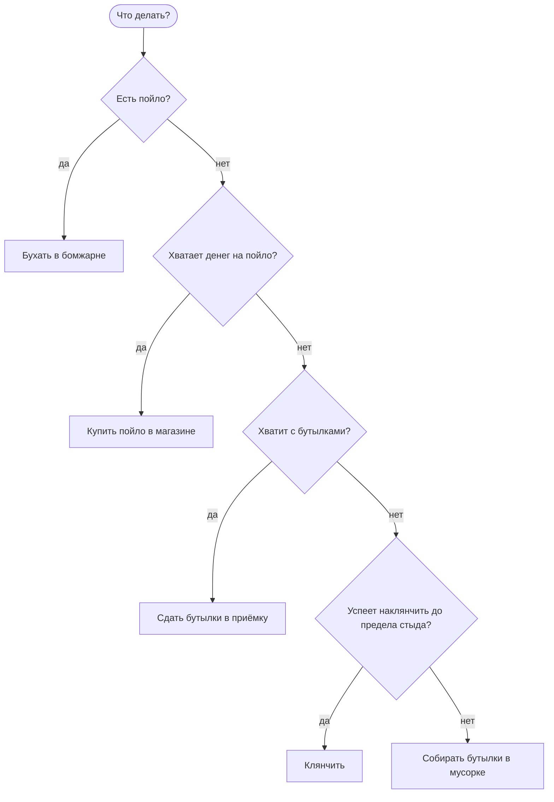

# Бомж-алкаш

Бомж-алкаш живёт в Монтгомери. Цель у него одна — бухать, а всё остальное он делает, чтобы
раздобыть на это пойло: собирает бутылки по мусоркам, сдаёт их в приёмку, клянчит у прохожих и
покупает пойло в магазине. Что делать прямо сейчас, бомж решает сам по тому, что у него есть, и
передумывает, если что-то пошло не так.

## Как он выбирает, что делать

Бомж перебирает дела по порядку и берётся за первое, которое у него получится:

1. **Бухать**, если есть пойло. Бомж идёт в ближайшую бомжарню, если он не в ней, и за 10 секунд
   выпивает бутылку. Пустая бутылка остаётся у него.
2. **Купить пойло**, если на него хватает денег. Бомж идёт в ближайший магазин и покупает одну
   бутылку.
3. **Сдать бутылки**, если они есть и с выручкой денег хватит на пойло. Бомж идёт в ближайшую
   приёмку и сдаёт все бутылки разом.
4. **Клянчить**, если на пойло не хватает и он рассчитывает успеть наклянчить, пока не стало
   слишком стыдно. Бомж садится на ближайшем месте для клянчанья и просит, пока не наберёт столько,
   сколько не хватает на пойло вместе с деньгами и бутылками, которые у него уже есть.
5. **Собирать бутылки**, если ничего из этого не вышло. Бомж идёт к случайной мусорке и роется в
   ней, пока не найдёт до 5 бутылок.

Когда дело закончено или сорвалось, бомж выбирает заново. Так из этих дел складывается круг: собрал
бутылки, сдал их, купил пойло, выпил — и снова за бутылками, тем более что одна пустая у него уже
есть.

## Деньги и бутылки

- Бутылка пойла стоит **$100**.
- За одну пустую бутылку в приёмке платят **$10**, так что на пойло нужно 10 бутылок.
- В мусорке бомж за секунду поисков находит бутылку с шансом **1 из 60**, то есть примерно одну
  бутылку в минуту. За один заход он ищет не больше **5** бутылок, а с собой унесёт не больше
  **15**.
- Когда бомж клянчит, ему каждую секунду с шансом **1 из 40** подают **$10**. Чтобы с пустыми
  карманами наклянчить на пойло, нужно в среднем около 400 секунд, то есть минут семь.

## Стыд

Клянчить стыдно. Стыд — чувство от 0 до 100:

- за каждую секунду клянчанья, подали или нет, стыд растёт на **0,1**;
- за каждую найденную в мусорке бутылку стыд падает на **2**: бомж сам заработал, а не
  попрошайничал, и это возвращает ему самоуважение.

Когда стыд доходит до **60**, бомж перестаёт клянчить, даже если не набрал, сколько хотел, и идёт
рыться в мусорках. Поэтому за один присест среднему бомжу хватает стыда примерно на 10 минут
клянчанья, а вот наклянчить на пойло с пустыми карманами — минут семь. Обычно он успевает.

Цифры выше — для бомжа со средним характером. Насколько быстро меняется стыд, зависит от
совестливости.

## Характер

Как устроены черты характера, описано в [Характер и чувства](../psyche/README.md). Для бомжа они
значат вот что:

- **Совестливость.** Самый бессовестный клянчит до предела стыда 20 минут, средний — 10, а самый
  совестливый — меньше 7. Найденная бутылка снимает у бессовестного 3 единицы стыда, у среднего — 2,
  у совестливого — 1.
- **Удачливость.** Удачливому подают в среднем раз в 27 секунд, а невезучему — раз в 60. Бутылку в
  мусорке удачливый находит примерно раз в 40 секунд, а невезучий — раз в полторы минуты.
- **Оптимизм.** Оптимист ждёт, что ему подадут примерно раз в 27 секунд, реалист — раз в 40,
  пессимист — раз в 60. Поэтому оптимист идёт клянчить смелее: ему кажется, что он успеет наклянчить
  на пойло, пока не стало слишком стыдно. А пессимист чаще сразу идёт к мусоркам.

Оптимист-неудачник рассчитывает, что ему подадут быстро, а на деле ждёт долго, поэтому чаще других
бросает клянчить на полпути от стыда.
