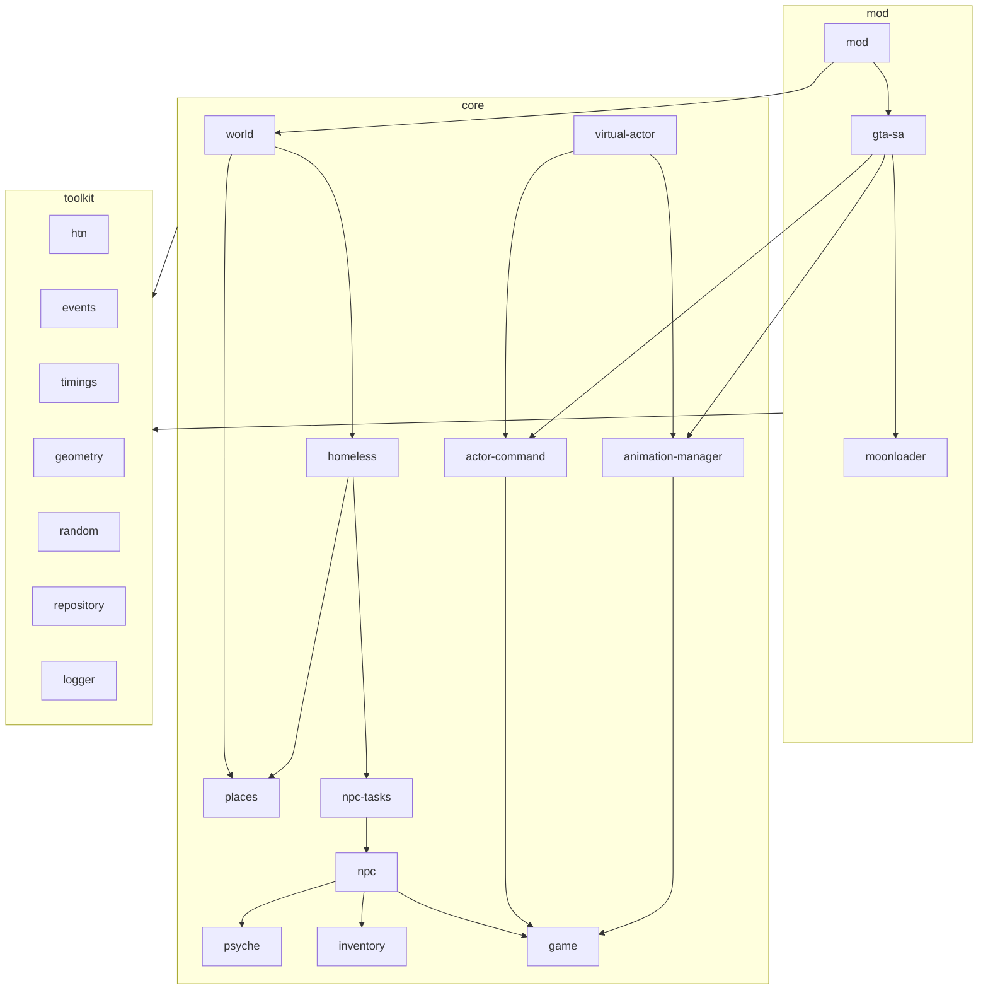
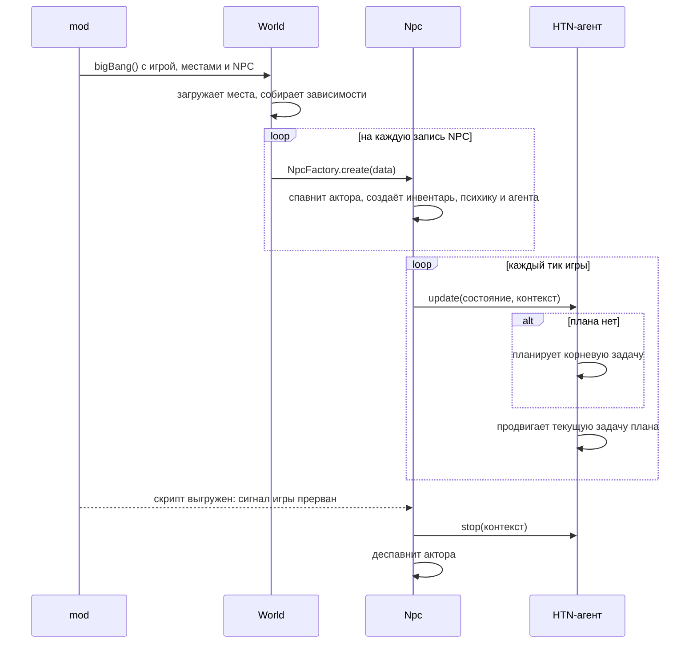

# Архитектура

## Чистота архитектуры

Архитектура чистая, если решение соблюдает все правила ниже. Чистота архитектуры стоит на первом
месте среди приоритетов проекта (см. [Зачем проект](../project.md#зачем-проект)).

### Слоистость

Слоистость соблюдается: нижний слой не знает о верхних (см. [Слои](#слои)).

### Независимые сущности

Сущности core не знают друг о друге. То, что сущности нужно от другой, передаётся ей снаружи через
интерфейсы и события, а не берётся у той напрямую.

Например, NPC не знает о мире: время суток он получает через `INpcWorldKnowledge`, которое ему
передаёт мир.

### Инверсия зависимостей

Класс получает объекты с поведением в зависимостях, а если пакету нужно что-то от пакета выше, он
сам объявляет интерфейс, а реализацию ему передают (см.
[Внедрение зависимостей](#внедрение-зависимостей)).

### Пакет собирает себя сам

Пакет собирает себя в своей точке сборки и требует снаружи только то, что ему взять неоткуда, а
наружу показывает только публичный API (см. [Пакет собирает себя сам](#пакет-собирает-себя-сам) и
[Точка входа пакета](#точка-входа-пакета)).

### Одна ответственность

Класс или пакет делает одну вещь и меняется по одной причине. Если для описания класса нужно
«и», это повод его разделить.

Например, актор только выполняет команды, а решает, что делать, NPC. Психика решает, как поступки
меняют чувства, а задача только сообщает ей о поступке.

### Тестируемость

Всё поведение core и toolkit проверяется тестами без игры, а тесты — это спецификация: по ним
видно, что и почему делает код. Если код трудно протестировать, это признак нарушения правил выше,
а не повод обойтись без тестов.

Например, задачи и NPC тестируются на виртуальном акторе, а время и шансы тесты задают сами.

### Обходы платформы — только в mod

Ограничения платформы, например MoonLoader и сборки в Lua, обходятся в слое mod и не протекают в
core и toolkit. Если обход платформы требует менять core или toolkit, ищется другой обход (см.
[Рантайм мода](#рантайм-мода)).

## Слои

Приложение разделено на три слоя:

- **toolkit** — утилиты, которые не зависят от бизнес-логики и могут использоваться в любой другой
  игре без изменений: планировщик HTN, события, геометрия, таймеры.
- **core** — бизнес-логика, актуальная конкретно для этого мира: мир, места, NPC, их психика,
  инвентарь и задачи. При этом сущности должны быть максимально независимыми друг от друга.
  Например, NPC не должен ничего знать о мире. Если ему нужно подписаться на тики, мир должен в
  конструкторе передать событие, на которое можно подписаться и которое будет вызываться каждый тик.
  Но не должно быть такого, что NPC подписывается на мир.
- **mod** — слой, который реализует сущности из core и заставляет их работать в игре. Мод собирает
  только то, что связано с игрой, и передаёт это миру вместе с данными: местами и NPC. Всё остальное
  мир собирает сам.

Слой более нижнего уровня не должен знать о слоях выше.

### Пакеты и зависимости

Стрелка ведёт от пакета к пакету, от которого он зависит. Пакеты toolkit не зависят от других
слоёв, а внутри toolkit от другого пакета зависят только таймеры: им нужны события.

На схеме показаны не все связи: прямые зависимости, которые уже следуют из других стрелок, опущены.
Например, `world` зависит и от `npc`, и от `psyche`, а `homeless` — от `npc` и `psyche`.

### Проверка слоёв

Направление зависимостей проверяет dependency-cruiser (`npm run check:deps`, конфиг —
`.dependency-cruiser.js`) в CI вместе с линтами, и нарушение валит пулл реквест. Он запрещает:

- зависимости toolkit от core и mod;
- зависимости core от mod;
- циклические зависимости между любыми модулями, в том числе через `import type`. Если двум модулям
  нужны типы друг друга, общий тип выносится в отдельный модуль, например в `types.ts`.

## Внедрение зависимостей

Класс не создаёт через `new` классы с поведением, а получает их фабрики в зависимостях. Так
поведение созданных объектов не попадает в тесты класса, который их создаёт, а сами объекты можно
заменить моками. Через `new` можно создавать только:

- примитивы toolkit, например, `AbortController` и `EventTarget`;
- объекты-данные, у которых нет поведения;
- зависимости по умолчанию в точке сборки (см. ниже).

### Пакет собирает себя сам

Каждый пакет core умеет собрать себя сам. Тому, кто им пользуется, не нужно знать, как пакет
устроен внутри, а нужно передать только то, что пакет взять неоткуда. Так мод не знает, что NPC
планируют через HTN, мир не знает, что у NPC есть инвентарь, а что бомж умеет клянчить, знает
только пакет бомжа. Пакетов toolkit правило не касается: в них нет бизнес-логики, которую нужно
собирать.

Собирает пакет его точка сборки — класс, который создают снаружи. Обычно это фабрика, например
фабрика NPC, фабрика психики или фабрика деятельности бомжа, а у всего приложения точка сборки —
мир.

- Снаружи точка сборки требует только то, что не может создать сама:
  - то, что приходит из игры: акторов, геометрию, кадры;
  - время и случайные числа, чтобы тесты ими управляли;
  - реализации своих интерфейсов из пакетов выше. Например, фабрика NPC требует фабрику корневых
    задач, потому что задачи лежат в пакетах, которые зависят от npc.
- Всё остальное точка сборки создаёт по умолчанию через `new`, а снаружи любую зависимость можно
  передать, и тогда она заменит значение по умолчанию.
- Значения по умолчанию собираются снизу вверх с учётом переданных зависимостей: если передана
  нижняя зависимость, верхние по умолчанию собираются с ней.
- Если зависимость должна быть общей для нескольких пакетов, её создаёт тот, кто собирает эти
  пакеты, и передаёт им одну и ту же. Например, мир передаёт одну фабрику психики и NPC, и задачам,
  чтобы задачи предсказывали реакцию такой же психики, как у NPC.
- Тесты точки сборки проверяют сборку так: передают зависимость моком и проверяют, что она дошла до
  того, кто ей пользуется, а без неё — что по умолчанию собралось то, что нужно.

## Точка входа пакета

Точка входа пакета (`src/index.ts`) экспортирует только его публичный API — то, чем пакетом
пользуются снаружи:

- точку сборки и типы её опций и зависимостей;
- то, что возвращают её методы;
- интерфейсы, через которые с пакетом работают снаружи или которые можно передать ему в
  зависимостях;
- перечисления и типы данных.

Детали реализации не экспортируются: классы, которые пакет создаёт внутри, их опции и зависимости,
константы. Например, `homeless` экспортирует `HomelessActivityTaskFactory`, но не `DrinkTask`. Тесты и
`dev` импортируют детали реализации своего пакета напрямую из файлов, например
`../src/drink-task`.

## Константы

Константы бывают двух видов:

- **Свойства модели** — то, что не настраивается: пределы чувств и черт, период попыток в задаче
  «пытать удачу», радиусы и допуски, с которыми NPC подходит к месту. Объявляются статическими
  полями класса, к которому относятся (`static readonly`), например `Psyche.MAX_FEELING` или
  `TryLuckTask.PERIOD`. Если поле нужно только самому классу, оно приватное.
- **Баланс** — то, что подбирается, чтобы игра шла как задумано: шансы, цены, награды, пороги,
  прирост и падение чувств. Лежит в `src/constants.ts` своего пакета, например цена пойла — в
  `homeless`, а прирост стыда — в `psyche`. Калибровка баланса — правка этого файла, а не классов.

Константы не экспортируются из точки входа пакета: это детали реализации.

## Жизненный цикл

Жизнь в игре проходит путь мир → NPC → HTN:

1. **Большой взрыв.** Мод создаёт игру и мир и вызывает `World.bigBang`. Мир загружает места,
   собирает зависимости по умолчанию и на каждую запись из репозитория NPC создаёт NPC фабрикой
   NPC.
2. **Рождение NPC.** NPC создаёт актора (тот появляется в игре), инвентарь, психику и HTN-агента с
   корневой задачей, которую мир собрал из слоёв для его типа. После этого NPC подписывается на
   тики игры.
3. **Тик.** На каждый тик NPC собирает состояние — слепок актора, сами инвентарь и психику только
   на чтение и время из знания о мире — и передаёт его агенту вместе с контекстом. Если плана нет, агент
   планирует корневую задачу, а затем продвигает текущую задачу плана.
4. **Перепланирование.** Когда план закончился или задача не удалась, агент забывает план и на
   следующем тике планирует заново с новым состоянием.
5. **Конец.** Когда игра завершается, её сигнал прерывается: NPC перестаёт слушать тики,
   останавливает агента, а тот — текущую задачу, и деспавнит актора.

## Рантайм мода

Мод пишется на TypeScript, а работает в MoonLoader — загрузчике Lua-скриптов для GTA San Andreas.

- **Сборка.** TypeScriptToLua собирает мод в один файл `peetland.lua` (`mod/mod/tsconfig.build.json`).
  MoonLoader запускает функцию `main`, которую мод кладёт в глобальную область.
- **Запуск.** `main` ждёт, пока игра загрузится, запускает таймеры и по клавишам вызывает
  отладочные действия: H — большой взрыв, G — печать координат игрока, J — телепорт к бомжарне.
- **Тики.** Игра (`GtaGame`) сообщает о тике раз в 250 мс по таймеру. Пока игра на паузе или не
  загружена, таймеры не срабатывают, и тиков нет. Когда скрипт выгружают, сигнал игры прерывается.

### Полифилы

В Lua нет того, к чему привык код на TypeScript, поэтому часть окружения проект делает сам:

- **Таймеры.** `setTimeout`, `setInterval` и их `clear*` реализованы в моде (`patch-global.ts`) и
  кладутся в глобальную область. Все таймеры работают в одном потоке MoonLoader: поток, созданный
  из колбэка другого таймера, после первого `wait` не продолжается.
- **`reportError`.** Сообщает об ошибке, которую некому обработать, например об исключении в
  обработчике события. Мод печатает её в `moonloader.log`, а в тестах это мок.
- **События.** `EventTarget`, `AbortController`, `AbortSignal` и `Observable` реализованы в
  `@peetland/events` по образцу браузерных API, потому что в Lua их нет.

Типы глобальных функций описаны в `mod/mod/_G.d.ts`.

### Ограничения Lua

- **`self`.** В Lua у функции либо есть `self`, либо нет. TypeScriptToLua проверяет это при сборке,
  но не видит, если метод передали без объекта или вызвали через `bind`, `call` и `apply`. Поэтому
  они запрещены линтером: вызов оборачивается в стрелочную функцию.
- **Потоки MoonLoader.** Поток нельзя создавать изнутри async-функции: он тихо портит память
  скрипта, и игра зависает или вылетает без ошибки в логе.
