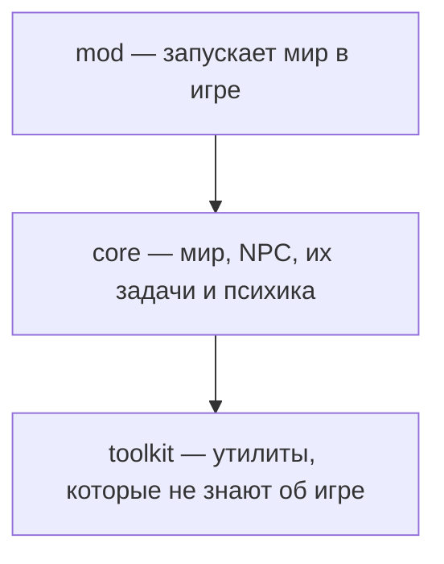

# Обзор

Peetland — мод для GTA San Andreas, в котором NPC живут своей жизнью. У каждого NPC есть характер,
чувства и вещи. Что делать дальше, он решает сам: планирует дела под то, что у него есть и что
вокруг, и перепланирует, когда что-то пошло не так.

Сейчас в мире живёт один NPC — бомж-алкаш из Монтгомери. Он собирает бутылки по мусоркам, сдаёт их в
приёмку, клянчит деньги, покупает пойло и идёт бухать в бомжарню. Как он поступит, зависит от
характера: совестливому стыдно клянчить, а оптимист идёт клянчить смелее пессимиста. Значения этих
и других терминов — в [глоссарии](./glossary/index.md).

## Зачем проект

Проект учебный. Его цель — разобраться в проектировании архитектуры приложений, паттернах,
инверсии зависимостей, разделении ответственности и тестировании. Работающий мод — приятный бонус,
но решения в проекте принимаются ради этой цели, а не ради скорости.

## Как он устроен

Код разделён на три слоя, и нижний слой не знает о верхних:

- **toolkit** — утилиты без бизнес-логики, которые подошли бы любой игре: планировщик HTN, события,
  геометрия, таймеры.
- **core** — бизнес-логика этого мира: мир, места, NPC, их психика, инвентарь и задачи. Об игре core
  знает только через интерфейсы, поэтому всё поведение проверяется тестами на виртуальных акторах
  без игры.
- **mod** — реализует интерфейсы игры для GTA San Andreas и запускает мир. Мод пишется на
  TypeScript, собирается в Lua и работает в MoonLoader.

NPC планирует свои дела через HTN: большая задача вроде «жить» раскладывается на задачи поменьше,
пока не останутся простые действия, например «дойти до мусорки» или «проиграть анимацию».

## Куда движется

- **Разнообразнее поведение.** У NPC появляются новые потребности, состояния и черты характера,
  поэтому NPC одного типа ведут себя по-разному.
- **Больше жителей.** Помимо бомжа в мире появляются NPC других типов, со своими целями и делами.
- **Живее мир.** Мир меняется со временем и влияет на планы NPC.
- **Мод на другой платформе.** core и toolkit не знают о MoonLoader, поэтому мир можно перенести на
  другую платформу, переписав только слой mod.
