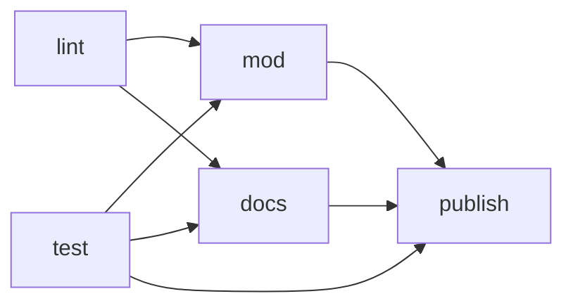

# CI и сборки

CI работает на GitHub Actions. Workflow три: на пулл реквесты, на мерж в `main` и на релиз.

## Пулл реквест

`pull-request.yml` запускается, когда пулл реквест открывают, переоткрывают или пушат в него. Новый
пуш отменяет предыдущий запуск.



- **lint** — проверка типов, eslint, dependency-cruiser и prettier по всему репозиторию.
  dependency-cruiser проверяет направление зависимостей между слоями и запрещает циклические
  зависимости (см. [Проверка слоёв](../architecture/index.md#проверка-слоёв)).
- **test** — тесты. Отчёт Allure о тестах публикуется на GitHub Pages, даже если тесты упали: на
  ревью он нужен, чтобы увидеть, что сломалось. В отчёт подкладывается история прогонов `main`, и по
  ней видно, какие тесты в пулл реквесте новые и какие нестабильны. Прогон пулл реквеста в историю
  `main` не попадает. Ссылка на отчёт — в окружении `tests` пулл реквеста.
- **mod** — собирает мод ветки. Ссылка на сборку — в окружении `mod` пулл реквеста.
- **docs** — собирает документацию ветки. Ссылка на неё — в окружении `docs` пулл реквеста.
- **publish** — публикует на GitHub Pages одним пушем всё, что собрали test, mod и docs. Каждый пуш
  в `gh-pages` запускает сборку GitHub Pages, а они идут друг за другом, поэтому один пуш вместо
  трёх экономит время. Джоба запускается, даже если test, mod или docs упали или пропущены.

Сборки мода и документации публикуются, только если проверки и тесты прошли. Если сборка не дошла
до публикации, в GitHub Pages остаётся её прошлая версия. Когда пулл реквест закрывают или мержат,
джоба **remove-pages** удаляет с GitHub Pages папку его ветки вместе со всеми сборками. Папка `main`
не удаляется, даже если `main` была веткой закрытого пулл реквеста.

## Мерж в main

`merge.yml` запускается на каждый пуш в `main`. Проверки и тесты уже прошли в пулл реквесте,
поэтому здесь только публикации: **mod** и **docs** собирают мод и документацию `main`, **tests**
запускает тесты ради отчёта о тестах `main`, а **publish** публикует всё это одним пушем. Отчёт
`main` хранит историю прогонов: перед генерацией джоба берёт `history.jsonl` из прошлого отчёта в
ветке `gh-pages`, Allure дописывает в неё новый прогон, и история публикуется вместе с отчётом.
Новый мерж отменяет предыдущий запуск.

## Релиз

`release.yml` выпускает релиз мода, когда закрывают milestone. Milestone — граница выпуска: в нём
видно, что изменилось для игрока, а сборка в релизе потом не меняется, в отличие от сборки `main` на
GitHub Pages.

- **mod** — собирает мод из `main` на момент закрытия milestone.
- **notes** — собирает заголовки и описания закрытых issue milestone и передаёт их Claude через
  `base-action` из `anthropics/claude-code-action`: сам `claude-code-action` не умеет запускаться на
  событии `milestone`. Claude пишет описание релиза для игрока: без технических деталей вроде CI,
  тестов и рефакторинга, с обобщением изменений вместо списка issue. Инструменты Claude не нужны,
  текст он возвращает структурированным ответом.
- **release** — публикует релиз с тегом `milestone-<номер milestone>` на коммите сборки. Заголовок
  релиза — название milestone, к релизу приложен `peetland.lua`.

Писать в репозиторий может только джоба release, а токен Claude есть только у notes. Токен — это
секрет репозитория `CLAUDE_CODE_OAUTH_TOKEN`: токен подписки Claude, который выдаёт
`claude setup-token`. Без него релиз не выйдет. Чтобы выпустить релиз, закрой milestone, когда все
его issue закрыты: в описание релиза попадают только закрытые issue.

## GitHub Pages

Сборки всех веток лежат в ветке `gh-pages`, у каждой ветки своя папка:

```
gh-pages
├── index.html        перенаправляет на main/docs/
├── .nojekyll         без него GitHub Pages не отдаёт файлы, которые начинаются с _
├── main
│   ├── docs          документация main
│   ├── mod           сборка мода main
│   └── tests         отчёт о тестах main
└── feat
    └── npc
        ├── docs
        ├── mod
        └── tests
```

Адрес сборки — `<адрес GitHub Pages репозитория>/<ветка>/<сборка>/`, например
`<адрес>/feat/npc/docs/`, `<адрес>/main/mod/peetland.lua` или `<адрес>/main/tests/`. `index.html` и
`.nojekyll` лежат в корне ветки `gh-pages` с самого начала, и публикация их не трогает. В настройках
репозитория GitHub Pages публикуется из ветки `gh-pages`.

## Общие шаги

Шаги, которые нужны обоим workflow, вынесены в композитные actions в `.github/workflows`:

- **prepare-environment** — ставит Node.js и зависимости;
- **lint** — проверяет типы, код, зависимости и форматирование;
- **build-mod** и **build-docs** — собирают мод и документацию ветки и загружают их через
  upload-pages;
- **build-tests** — запускает тесты, собирает отчёт Allure с историей прогонов `main` и загружает
  его через upload-pages, в том числе при упавших тестах. Отчёт `main` дописывает в историю свой
  прогон;
- **upload-pages** — загружает сборку артефактом запуска, чтобы её опубликовал publish-pages;
- **publish-pages** — скачивает артефакты сборок и одним пушем публикует их в `<ветка>/<сборка>`
  ветки `gh-pages` пакетом `gh-pages`. Заменяются только папки скачанных сборок, остальные папки
  ветки остаются как есть. Сборки всех веток лежат в одной ветке, поэтому пуши параллельных
  запусков могут конфликтовать: тогда публикация повторяется со свежей веткой;
- **remove-pages** — удаляет папку ветки из `gh-pages`.
