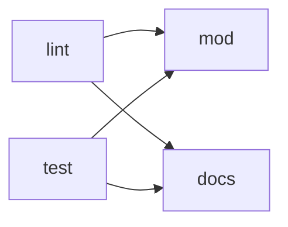

# CI и сборки

CI работает на GitHub Actions. Workflow два: один на пулл реквесты, другой на мерж в `main`.

## Пулл реквест

`pull-request.yml` запускается, когда пулл реквест открывают, переоткрывают или пушат в него. Новый
пуш отменяет предыдущий запуск.



- **lint** — проверка типов, eslint и prettier по всему репозиторию.
- **test** — тесты. Отчёт Allure о тестах публикуется на GitHub Pages, даже если тесты упали: на
  ревью он нужен, чтобы увидеть, что сломалось. В отчёт подкладывается история прогонов `main`, и по
  ней видно, какие тесты в пулл реквесте новые и какие нестабильны. Прогон пулл реквеста в историю
  `main` не попадает. Ссылка на отчёт — в окружении `tests` пулл реквеста.
- **mod** — собирает мод и публикует сборку ветки на GitHub Pages. Ссылка на неё — в окружении
  `mod` пулл реквеста.
- **docs** — собирает документацию и публикует её на GitHub Pages. Ссылка на неё — в окружении
  `docs` пулл реквеста.

Сборки мода и документации публикуются, только если проверки и тесты прошли. Когда пулл реквест
закрывают или мержат, джоба **remove-pages** удаляет с GitHub Pages папку его ветки вместе со всеми
сборками. Папка `main` не удаляется, даже если `main` была веткой закрытого пулл реквеста.

## Мерж в main

`merge.yml` запускается на каждый пуш в `main`. Проверки и тесты уже прошли в пулл реквесте,
поэтому здесь только публикации: **mod** и **docs** публикуют сборку мода и документацию `main`, а
**tests** запускает тесты ради отчёта о тестах `main`. Отчёт `main` хранит историю прогонов:
перед генерацией джоба берёт `history.jsonl` из прошлого отчёта в ветке `gh-pages`, Allure
дописывает в неё новый прогон, и история публикуется вместе с отчётом. Новый мерж отменяет
предыдущий запуск.

## GitHub Pages

Сборки всех веток лежат в ветке `gh-pages`, у каждой ветки своя папка:

```
gh-pages
├── index.html        перенаправляет на main/docs/
├── .nojekyll         без него GitHub Pages не отдаёт файлы, которые начинаются с _
├── main
│   ├── docs          документация main
│   ├── mod           сборка мода main
│   └── tests         отчёт о тестах main
└── feat
    └── npc
        ├── docs
        ├── mod
        └── tests
```

Адрес сборки — `<адрес GitHub Pages репозитория>/<ветка>/<сборка>/`, например
`<адрес>/feat/npc/docs/`, `<адрес>/main/mod/peetland.lua` или `<адрес>/main/tests/`. `index.html` и
`.nojekyll` лежат в корне ветки `gh-pages` с самого начала, и публикация их не трогает. В настройках
репозитория GitHub Pages публикуется из ветки `gh-pages`.

## Общие шаги

Шаги, которые нужны обоим workflow, вынесены в композитные actions в `.github/workflows`:

- **prepare-environment** — ставит Node.js и зависимости;
- **lint** — проверяет типы, код и форматирование;
- **deploy-mod** и **deploy-docs** — собирают мод и документацию ветки и публикуют их через
  publish-pages;
- **publish-pages** — публикует папку в `<ветка>/<сборка>` ветки `gh-pages` пакетом `gh-pages`.
  Сборки всех веток лежат в одной ветке, поэтому пуши параллельных запусков могут конфликтовать:
  тогда публикация повторяется со свежей веткой;
- **deploy-tests** — запускает тесты, собирает отчёт Allure с историей прогонов `main` и публикует
  его через publish-pages, в том числе при упавших тестах. Отчёт `main` дописывает в историю свой
  прогон и публикует её;
- **remove-pages** — удаляет папку ветки из `gh-pages`.
